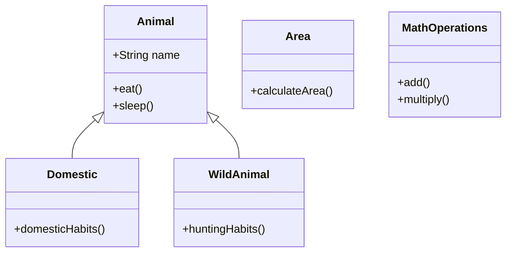

<p align="center">
  
</p>

<p align="center">
  
  
  
  
  
</p>

---

## Executive Summary / Overview
### Problem Statement & Context
Large-scale software applications require robust structural boundaries to prevent tight coupling and fragile maintenance cycles. Without disciplined Object-Oriented Design (OOD)—including proper encapsulation, abstract base contracts, and dynamic method dispatch—codebases quickly degenerate into spaghetti code that cannot scale.

### Solution Overview
This repository implements a comprehensive suite of **21 Java Object-Oriented Programming (OOP) Modules**. It explores the four foundational pillars of OOP—**Encapsulation, Abstraction, Inheritance, and Polymorphism**—demonstrating constructor overloading, hierarchical inheritance chains, method overriding, and mathematical utilities.

---

## Interactive Table of Contents
- [Executive Summary / Overview](#executive-summary--overview)
- [Key Features & Capabilities](#key-features--capabilities)
- [System Architecture / Pipeline](#system-architecture--pipeline)
- [Tech Stack Breakdown](#tech-stack-breakdown)
- [Reproducible Quickstart & Setup](#reproducible-quickstart--setup)
- [Project Directory Layout](#project-directory-layout)
- [Author & Contributions](#author--contributions)

---

## Key Features & Capabilities
- **Hierarchical Inheritance Trees:** Multi-level class hierarchies modeling real-world abstractions (e.g., `Animal` -> `Domestic` / `WildAnimal`).
- **Dynamic Polymorphism & Overriding:** Subclass runtime method dispatch demonstrating polymorphic behavioral overrides.
- **Encapsulation & Access Invariants:** Proper encapsulation isolating internal mutable state behind access methods.
- **Constructor Overloading:** Robust class instantiation pathways utilizing default, parameterized, and chained constructors.

---

## System Architecture / Pipeline


---

## Tech Stack Breakdown
| Layer | Technology | Details |
| :--- | :--- | :--- |
| **Languages** | Java (JDK 17+) | Strongly-typed object-oriented language |
| **Libraries** | Java Standard Class Library (`java.lang`, `java.util`) | Core collections and string manipulation |
| **Tools** | `javac`, `java`, Eclipse IDE | Bytecode compilation and runtime execution |
| **Architecture** | Classic Object-Oriented Architecture | Four pillars: Encapsulation, Inheritance, Polymorphism, Abstraction |

---

## Reproducible Quickstart & Setup
```bash
# 1. Clone repository
git clone https://github.com/suryateja-155/JAVA-ASSIGNMENT_2.git
cd JAVA-ASSIGNMENT_2

# 2. Compile Java classes
javac *.java

# 3. Execute sample program
java CLASS_Main
```

---

## Project Directory Layout
```text
JAVA-ASSIGNMENT_2/
├── Animal.java           # Base abstract entity for animal hierarchy
├── Domestic.java         # Subclass modeling domestic behaviors
├── WildAnimal.java       # Subclass modeling wild animal behaviors
├── Area.java             # Geometric area calculations and shape contracts
├── ConstructorMain.java  # Constructor overloading and instantiation tests
├── MathOperations.java   # Arithmetic utility library and method overloading
├── Employee.java         # Corporate entity encapsulation model
└── README.md             # Object-oriented architecture and inheritance guide
```

---

## Author & Contributions

**Gettupalli Surya Teja**  
- GitHub Profile: [@suryateja-155](https://github.com/suryateja-155)  
- Portfolio Index: [Gettupalli-Surya-Teja](https://github.com/suryateja-155/Gettupalli-Surya-Teja)

Contributions, issue reports, and feedback are always welcome! Feel free to open an issue or pull request.

<p align="center">
  
</p>
